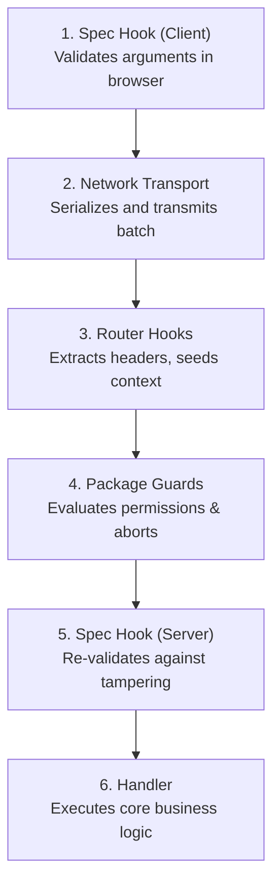

# Interceptors, Guards & Spec Hooks

Interceptors extract cross-cutting concerns (authentication, role authorization, argument validation, telemetry) from individual handlers into a declarative, multi-stage pipeline.

---

## The Interception Pipeline

Every IRPC request progresses through six sequential execution boundaries:



If any layer throws an exception, the execution pipeline halts immediately and propagates the error back to the caller as a rejected promise.

---

## Router Hooks (`router.use`)

Router hooks operate at the **router boundary**. They are blind to specific function names and arguments; their purpose is parsing transport headers and building shared request context:

```typescript
// server.ts
import { HTTPRouter } from '@irpclib/http/router';
import { getContext, setContext } from '@irpclib/irpc';
import { transport } from '@/src/api.js';
import { verifyJwt } from '@/src/lib/auth.js';

const router = new HTTPRouter(transport);

router.use(async () => {
  // 1. Read raw transport data injected via initContext
  const token = getContext<string>('token');
  if (!token) {
    throw new Error('Unauthorized: Missing auth token');
  }

  // 2. Hydrate verified user context for downstream layers
  const user = await verifyJwt(token);
  setContext('user', user);
});
```

Because router hooks run before any guards or handlers, downstream code can reliably assume `getContext('user')` is populated.

---

## Package Guards (`irpc.guard`)

Guards operate at the **handler boundary**. They intercept requests at the package level to make authorization decisions based on context and target function name.

Guards must strictly reside in server-side files (`constructor.ts` colocated next to routes) to avoid leaking security logic or database access into client bundles:

```typescript
// pages/admin/constructor.ts
import { irpc } from '@/src/api.js';
import { GuardError, getContext, getAbortSignal } from '@irpclib/irpc';
import { db } from '@/src/lib/database.js';

irpc.guard(async (req) => {
  const signal = getAbortSignal();
  const user = getContext<{ id: string; role: string }>('user');

  // Prevent execution of destructive operations by non-admins
  if (req.name.startsWith('admin.') && user?.role !== 'admin') {
    throw GuardError.failed('Forbidden: Admin privilege required');
  }

  // Pass AbortSignal to database queries to drop dead operations
  const account = await db.accounts.find(user.id, { signal });
  if (!account?.isActive) {
    throw GuardError.failed('Forbidden: Account is suspended');
  }
});
```

### Key Guard Features

- **`GuardError.failed(message)`**: Halts execution cleanly and returns a standardized error code rather than an unhandled 500 error.
- **`getAbortSignal()` Integration**: If a client unmounts or aborts the request, the abort signal fires immediately, enabling cancellation of heavy queries.

---

## Spec Hooks (`irpc.hook`)

Spec hooks operate at the **domain boundary**. They bind to a specific function stub and run **isomorphically** on both client and server.

Because spec hooks represent pure domain assertions, they are defined directly in the declaration file (`function.ts`):

```typescript
// pages/users/function.ts
import { irpc } from '@/src/api.js';

export type DeleteUserFn = (userId: string) => Promise<void>;
export const deleteUser = irpc.declare<DeleteUserFn>('user.delete', {
  seed: () => undefined,
});

// Bundled and executed on BOTH client and server
irpc.hook(deleteUser, (req) => {
  const [userId] = req.args;

  // Validation regex
  const uuidRegex = /^[0-9a-f]{8}-[0-9a-f]{4}-[1-5][0-9a-f]{3}-[89ab][0-9a-f]{3}-[0-9a-f]{12}$/i;
  if (!uuidRegex.test(userId)) {
    throw new Error('Invalid User ID: Must be a valid UUID');
  }
});
```

### Why Isomorphic Execution Matters

- **Client-Side Feedback**: Runs immediately in the browser when `deleteUser('bad-id')` is invoked. It throws before network serialization, giving immediate UI feedback and avoiding a wasted HTTP roundtrip.
- **Server-Side Trust**: When the request arrives at the server, the exact same hook executes again right before the handler, preventing malicious requests from bypassing client validation.

---

## Layer Comparison Matrix

| Layer | API | Scope | Placement | Execution Environment |
|---|---|---|---|---|
| **Router Hook** | `router.use()` | Global transport | `server.ts` | Server only |
| **Package Guard** | `package.guard()` | Package namespace | `pages/**/constructor.ts` | Server only |
| **Spec Hook** | `irpc.hook()` | Single function stub | `pages/**/function.ts` | Client & Server (Isomorphic) |
