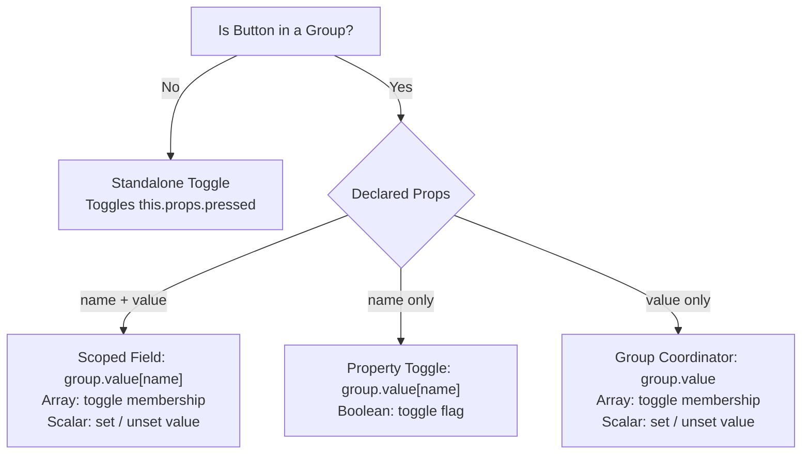

# ARIA Package Specification & WAI-ARIA Reference

The `@beerush/aria` package is a headless, framework-agnostic accessibility controller foundation for UI components. It bridges reactive state machines with the standard W3C WAI-ARIA specification, compiling deterministic attribute snapshots for SSR/JSX rendering and managing DOM lifecycles.

---

## Package Mission & Responsibilities

The core job of the `aria` package is to:

1. **Model WAI-ARIA Semantics & State**: Encapsulate interactive states (`disabled`, `pressed`, `checked`, `expanded`, `selected`, `value`) within reactive proxies so accessibility states automatically recompute upon state changes.
2. **Compile Deterministic Attribute Dictionaries**: Compute pure HTML and ARIA attribute dictionaries (`role`, `aria-*`, `tabindex`, `disabled`, `type`, `class`, `style`) for SSR and template spreading (`.attributes`), excluding `on*` event handlers to decouple serialized markup from DOM event execution.
3. **Manage Fine-Grained DOM Lifecycles (`ref`)**: Bind to target DOM elements, diff and synchronize attributes directly onto DOM nodes, and manage direct DOM event listener registration and detachment.
4. **Polyfill Non-Native Elements**: Provide keyboard triggers (Enter/Space activation, arrow-key navigation) and accessibility semantics when users bind controllers to non-native tags (`div`, `span`), while preserving browser-native behavior when bound to native HTML tags (`button`, `input`).
5. **Compose Event Handlers**: Ensure internal accessibility behaviors and state transitions execute first, then seamlessly forward events to user-defined refiner listeners with fresh, transitioned state.
6. **Zero-Cost Framework Translation**: Translate attributes to framework-specific conventions (e.g. `class` &rarr; `className` for React) outside the reactive observation loop with cached results for zero-allocation JSX spread.
7. **Composable Architecture**: Provide a lean, single-element controller (`Aria<E, T, A>`) that composite widgets (Tabs, Combobox, Accordion, Dialog) compose into parent-child controller graphs.

---

## Architectural Contracts

### Public API Surface
External consumers and template authors interact with:
- **`.attributes`**: Normalized HTML and ARIA attribute dictionary for template spread (`role`, `tabindex`, `aria-*`, `class`, `style`). Excludes `on*` event handlers.
- **`.current`**: React `RefObject` compatible getter/setter for DOM element access (`widget.current?.focus()`).
- **`.ref`**: Universal callback ref for DOM attachment across React, Solid, Svelte, and vanilla DOM (`ref={widget.ref}`).
- **`.props`**: Reactive inputs proxy for reading and mutating component properties.
- **`.scope`**: Enclosing parent `Aria` controller captured during construction via ambient scope chaining (`this.scope = ariaScope.get()`).
- **State Projections**: First-class reactive getters/setters exposing computed role states for template conditionals, class toggles, and direct mutations (`widget.selected`, `widget.expanded`, `widget.checked`, `widget.disabled`, `widget.open`).
- **`.isNative`**: Read-only flag indicating whether the controller is configured for a native HTML element (`!!this.options.native`), guaranteeing deterministic attribute compilation across SSR and client hydration.
- **`.assign(partial)`**: Batch updates reactive props atomically.
- **`.refine(fn)`**: Injects custom attributes, styles, or composed event listeners; returns an unregister cleanup callback (`() => void`) to prevent memory leaks and zombie attributes.
- **`.destroy()`**: Cleans up observers, unbinds DOM listeners, and releases element references.

### DOM Event Attachment & Lifecycle
Event listeners are bound directly to the mounted DOM element through the `applyAttributes` utility:
- **Registration**: Event handlers declared with `on*` prefixes (built-in role behaviors and consumer-injected refiners) are attached to the element via `addEventListener`.
- **Reconciliation**: When an event handler reference updates across reactive ticks, the previous listener is detached via `removeEventListener` and the replacement listener is attached.
- **Teardown**: When an attribute refiner unregisters, its associated event listeners are detached from the element.

### Protected Subclass SPI (`Aria<E, T, A, O extends AriaOptions = AriaOptions>`)
Specialized widget implementations (e.g. `ButtonAria`, `SliderAria`) extend base `Aria`:
- **`protected options`**: Controller configuration options (`native` and subclass-specific options).
- **`protected element`**: The bound DOM element reference for internal queries and DOM APIs.
- **`protected omittedAttrs`**: Array of protected attribute keys shielded from external mutation or override by consumer `.refine()` calls.
- **`protected attrs`**: Normalized attribute dictionary containing internal role attributes and `on*` event handlers prior to public projection.
- **`protected createAttributes()`**: Pure factory computing base HTML/ARIA attributes and event handlers for the role.
- **`protected attach()`**: Lifecycle hook invoked when the DOM element mounts, returning a detachment cleanup function.

> [!IMPORTANT]
> **Prohibit ECMAScript Hard Private Fields (`#field`)**: Never use `#field` syntax in controllers. Hard private fields are completely inaccessible to subclasses, break class inheritance, prevent method overrides, and cause runtime `TypeError` when accessed across reactive `Proxy` instances. Always use TypeScript soft access modifiers (`protected` / `private`) so subclasses can cleanly inherit and coordinate state.

### Composite Widget Architecture & Contracts

Every `Aria` controller instance governs exactly one DOM element. Composite WAI-ARIA widgets (Tabs, Menu, Combobox, RadioGroup, Accordion, Toolbar) are coordinated graphs of discrete `Aria` instances operating through self-discovery and shared reactive state:

---

#### 1. Logical Component Hierarchy vs Semantic DOM Hierarchy
In WAI-ARIA, the logical component tree must not be conflated with the rendered DOM hierarchy:
- **Logical Root Orchestrator (`Tabs`)**: Owns the single reactive state store (`value`, `orientation`, `manual`, `id`) and publishes ambient context (`tabsCtx.set(this)`). It renders as a pure fragment or un-roled structural wrapper (`<div class="tabs">`). It does **not** bind to `role="tablist"` directly, because WAI-ARIA strictly prohibits `tabpanel` elements from existing as DOM children inside a `tablist`.
- **Semantic DOM Elements**:
  - **`tabs.list()` &rarr; `TabListAria`**: Binds to `<div role="tablist">`. Has **no independent state** of its own; it reads and mutates the parent's `this.tabs.state`. Manages roving tabindex keyboard navigation across child tabs.
  - **`tabs.tab()` &rarr; `TabButtonAria`**: Binds to `<button role="tab">` inside `<div role="tablist">`.
  - **`tabs.panel()` &rarr; `TabPanelAria`**: Binds to `<div role="tabpanel">` rendered as a sibling **outside** `<div role="tablist">`.

```tsx
// Logical Component Tree (Context Hierarchy)
<Tabs value="profile">              {/* Logical Root: Owns state.value, publishes tabsCtx, NO ARIA role */}
  <TabList>                         {/* DOM: <div role="tablist"> (TabListAria: No state, shares this.tabs.state) */}
    <TabButton name="profile">      {/* Semantic identity: name="profile" (DOM: <button role="tab">) */}
    <TabButton name="security">     {/* Semantic identity: name="security" (DOM: <button role="tab">) */}
  </TabList>
  <TabPanel name="profile">         {/* Paired by matching name="profile" (DOM: <div role="tabpanel">) */}
  <TabPanel name="security">        {/* Paired by matching name="security" (DOM: <div role="tabpanel">) */}
</Tabs>
```

```tsx
// TabList.tsx (Child Component)
const tabs = tabsCtx.get();
const list = tabs.list(); // TabListAria shares tabs.state

// TabButton.tsx (Child Component)
const tabs = tabsCtx.get();
const button = tabs.tab({ name: 'profile' });

// TabPanel.tsx (Child Component)
const tabs = tabsCtx.get();
const panel = tabs.panel({ name: 'profile' });
```

This decouples the visual component tree from DOM hierarchy depth, allowing intermediate markup and layout styling without manual controller prop-drilling while enforcing strict WAI-ARIA DOM validity.

---

#### 2. Deterministic ID Generation & Pair Addressing
Controllers generate stable, context-scoped identifiers using `uIndex(..., true)` with declared role symbol constants to guarantee SSR and client hydration parity:

```ts
const ROLE_TABS = 'tabs';
const ROLE_TABLIST = 'tablist';
const ROLE_TAB = 'tab';
const ROLE_TABPANEL = 'tabpanel';

const TABS_INDEX = $symbol(ROLE_TABS);
const TABLIST_INDEX = $symbol(ROLE_TABLIST);
const TAB_INDEX = $symbol(ROLE_TAB);
const TABPANEL_INDEX = $symbol(ROLE_TABPANEL);

// Parent Orchestrator
public id = `${ROLE_TABS}-${uIndex(TABS_INDEX, true)}`;

// Child Parts
public id = `${ROLE_TAB}-${uIndex(TAB_INDEX, true)}`;
```

During attribute generation (`createAttributes()`), child elements derive paired DOM identifiers dynamically from the parent's resolved namespace (`const parentId = this.tabs.state.id ?? this.tabs.id`) and the child's semantic key (`const key = this.key`):

```ts
// Inside TabButton.createAttributes()
return {
  id: `${parentId}-${ROLE_TAB}-${key}`,
  'aria-controls': `${parentId}-${ROLE_TABPANEL}-${key}`,
};

// Inside TabPanel.createAttributes()
return {
  id: `${parentId}-${ROLE_TABPANEL}-${key}`,
  'aria-labelledby': `${parentId}-${ROLE_TAB}-${key}`,
};
```

Child controllers protect `'id'`, `'aria-controls'`, and `'aria-labelledby'` in their `this.omit` lists to preserve pair synchronization.

Pairing between elements is strictly addressable through deterministic state and key derivation, never through cross-instance references:
- **Zero Cross-Instance References**: Triggers never reference panels (`this.panel` does not exist), and panels never reference triggers (`this.button` does not exist).
- **Independent Lifecycles**: Triggers and panels inhabit disparate component subtrees, mount and unmount asynchronously, and may be lazy-loaded independently without coupling or synchronization leaks.
- **Deterministic Coordinate Mapping**: The accessibility linkage (`aria-controls` &harr; `id` &harr; `aria-labelledby`) is computed as a pure function `f(parentId, role, key)`. Because counterpart controllers share the ambient parent identity and match on semantic `key`, pairing is mathematically guaranteed without holding relational object references.

---

#### 3. Semantic Naming: Identity (`name`) vs Active State (`value`)
Controllers distinguish item identity from widget selection through explicit semantic naming:
- **Container Coordinator (`value` or Dictionary)**: The root orchestrator's state coordinates selection across children (e.g. `<Tabs value="profile">`, `<Toolbar formatting={{ bold: true }}>`).
- **Child Parts (`name`)**: Discrete interactive triggers, toggles, buttons, and panels declare `name` as their **semantic identity** (e.g. `<TabButton name="profile">`, `<Button name="bold">`).
- **Key Resolution Precedence**: Child parts resolve their addressable `key` via:
  ```ts
  public get key(): string {
    return this.props.name ?? this.props.value ?? this.props.id ?? this.id;
  }
  ```
  `name` takes primary precedence as the semantic identifier. `value` and `id` are supported as secondary fallbacks for form-native elements (`<Radio value="...">`) and DOM compatibility.

##### Group Selection Models & Signals (Single vs. Multiple)
The controller dynamically detects and switches between selection modes during both **state synchronization** and **activation (`select()`)** based on declared child props and the container's state shape:



1. **Named Field with Item Value (`name` + `value`)**:
   - **Component Pattern**: `<Button name="formatting" value="bold">`
   - **Target**: Operates on `group.value[this.name]` as a scoped field.
   - **Multi-Select (Array)**: If `Array.isArray(group.value[this.name])`, checks `group.value[this.name].includes(this.value)`. Activating toggles array membership.
   - **Single-Select (Scalar)**: If `group.value[this.name]` is scalar, checks `group.value[this.name] === this.value`. Activating assigns `group.value[this.name] = this.value` (or toggles to `undefined`).

2. **Direct Property Toggle (`name` only)**:
   - **Component Pattern**: `<Button name="bold">` (e.g. Rich Text Toolbar `<Toolbar value={{ bold: true }}>`)
   - **Target**: Operates directly on the group value dictionary (`group.value[this.name]`).
   - **Active Check**: `this.pressed = Boolean(group.value[this.name]);`
   - **Activation**: Toggles the boolean flag: `group.value[this.name] = !group.value[this.name];`
   - **Fine-Grained Advantage**: Mutating `group.value.bold` triggers *only* the observer of the button matching `name="bold"`. Sibling buttons (`italic`, `underline`) do not re-render.

3. **Choice Item (`value` only)**:
   - **Component Pattern**: `<Button value="left">` (e.g. Alignment Segmented Control, Filter Tabs)
   - **Target**: Operates on the group's default coordinator state (`group.value`).
   - **Single-Select**: If `group.value` is scalar, checks `group.value === this.value`. Activating assigns `group.value = this.value` (or toggles to `undefined` if deselectable).
   - **Multi-Select Fallback**: If `Array.isArray(group.value)`, checks `group.value.includes(this.value)`. Activating toggles array membership.

4. **Standalone Toggle Button (No Group)**:
   - **Component Pattern**: `<Button pressed={false}>`
   - **Target**: Local reactive props (`this.props.pressed`).
   - **Activation**: `this.pressed = !this.pressed;`

##### Self-Claiming Initial Selection ($static)
To prevent children from rendering as unselected during the initial render or SSR pass when a **mutually-exclusive single-selection group** (`Tabs`, `RadioGroup`, `!this.isToggle`) has no initial value, the child **self-claims** selection synchronously on initialization inside `$static`:

```ts
if (this.group && !this.isToggle) {
  $static(() => {
    if (!('value' in this.group!) || this.props.selected) {
      this.group!.value = this.key;
    }
  });
}
```

- **Mutually-Exclusive Guard (`!this.isToggle`)**: Only single-selection groups require a guaranteed active item on initial render. Toggle groups, checkboxes, and multi-select groups naturally default to empty/unselected states and must never auto-claim selection.
- **Uncontrolled Detection**: Using `!('value' in this.group)` distinguishes an uncontrolled parent (where `value` was omitted) from a controlled parent where `value` was explicitly provided as `undefined`, `null`, `""`, or `0`.
- **SSR Parity**: Guarantees the first item (or the item marked `selected: true`) synchronously evaluates `selected === true` (`aria-selected="true"`, `tabindex="0"`) on the initial pass in both SSR and client rendering without waiting for post-mount parent reconciliation.
- **Untracked Execution (`$static`)**: Evaluates outside the reactive observation loop to prevent subscribing outer tracking scopes to group mutations during constructor instantiation.

##### The Three-Layer Architecture: Props, Attributes, and Options
Controllers strictly isolate three distinct concerns to prevent state pollution, preserve live reactive proxies, and avoid non-HTML DOM attribute leakage:

1. **`props` (Reactive Inputs)**: Dynamic inputs that change over time and drive rendering (`disabled`, `pressed`, `value`, `name`). In component setup (`setup((props) => ...)`), `props` is passed directly as an intact reactive proxy reference (`this.props`).
2. **`attributes` (DOM Projection)**: Normalized HTML and WAI-ARIA attributes rendered to the target element (`role`, `tabindex`, `aria-*`, `disabled`).
3. **`options` (Controller Configuration)**: Static behavioral flags that dictate how the controller functions (`native`, `toggle`, etc.). Passed separately from `props` so component authors never need to spread props (`{ ...props, toggle: true }`), which would destroy reactive proxy traps.

##### The Native vs. Pure ARIA Contract (`{ native?: boolean }`)
During SSR, DOM elements do not exist (`this.element === null`). The controller cannot inspect the DOM to determine whether the template renders a native HTML element (`<button>`, `<input>`) or a custom element (`<div>`, `<span>`). To guarantee 100% deterministic compilation between SSR and client hydration:

1. **Deterministic Configuration**:
   - `this.isNative` evaluates strictly from `!!this.options.native`.
   - Never relies on runtime DOM tag guessing (`this.element?.tagName === ...`), ensuring zero hydration mismatches.

2. **Sensible DX Defaults**:
   - Roles wrapping native HTML elements by default (`button`, `checkbox`) default to `{ native: true }` in their controller options, eliminating boilerplate in standard UI components.
   - Roles without native HTML counterparts (`switch`) are strictly pure ARIA (`native: false`).

3. **Output Isolation**:
   - **When `isNative === true` (Native Elements)**:
     - Emits native HTML attributes (`type`, `checked`, `indeterminate`).
     - Omits redundant implicit ARIA roles (e.g. `role="button"` on `<button>`, `role="checkbox"` on `<input type="checkbox">`).
     - Delegates Space/Enter key navigation directly to the browser (disables synthetic polyfills).
   - **When `isNative === false` (Custom Elements)**:
     - Emits explicit WAI-ARIA roles (`role="button"`, `role="checkbox"`) and state attributes (`aria-checked="true" | "false" | "mixed"`).
     - Activates keyboard navigation polyfills (Space/Enter) so custom elements behave accessibly.
     - Omits invalid HTML attributes (`type`, `checked`, `indeterminate`) that do not belong on non-input tags.

##### Reversibility & Deselection: The `toggle` Option Contract
Single-choice group items can be configured to allow toggling off to an empty state (`undefined`) using the `options` configuration parameter:

```ts
export interface ButtonProps {
  disabled?: boolean;
  pressed?: boolean | 'mixed';
  value?: AnyType;
  name?: string;
}

export interface ButtonOptions {
  toggle?: boolean;
}

export type ButtonGroupProps = {
  value?: AnyType;
  disabled?: boolean;
  [key: string]: AnyType;
};

export interface ButtonGroupOptions {
  toggle?: boolean;
}
```

- **Group-Level Configuration (`group.options.toggle`)**: When `toggle = true`, all single-choice items in the group can deselect themselves to `undefined`.
- **Item-Level Configuration (`button.options.toggle`)**: When `toggle = true` (or initialized with `'pressed' in this.props`), that specific button allows toggling off.
- **Resolution Precedence**:
  ```ts
  const isToggle = this.options.toggle ?? this.group?.options?.toggle ?? ('pressed' in this.props);
  ```
  - If `isToggle === true`: Activating an already-active item unsets the value to `undefined`.
  - If `isToggle === false`: Activating an already-active item is idempotent (preserves selection, matching Radio and Tab behavior).

---

#### 4. State-Driven Rendering & Synchronous Selection
All dynamic attributes (`aria-selected`, `aria-pressed`, `tabindex`, `hidden`) are pure projections of reactive state.

To support clean template conditionals (`{panel.selected && <Content />}`), dynamic class bindings (`class={{ active: button.selected }}`), and programmatic control, all computed accessibility states must be exposed as first-class public reactive getters and setters on the controller instance:

```ts
// Inside TabButtonAria & TabPanelAria
public get selected(): boolean {
  return this.tabs.props.value === this.key;
}

public set selected(active: boolean) {
  if (this.props.disabled || !active) return;
  this.tabs.props.value = this.key;
}

protected createAttributes() {
  return {
    'aria-selected': this.selected ? 'true' : 'false',
    tabindex: this.selected ? 0 : -1,
  };
}
```

##### State Transition Models: Exclusive Selection vs Toggle
Controllers implement one of two transition models based on role semantics:
- **Exclusive Selection (`tab`, `radio`)**:
  - Enforces single-active cardinality across the group: exactly one item is active at all times once initialized.
  - Activating an item assigns the container value (`this.parent.props.value = this.key`).
  - An active item cannot deselect itself (`selected = false` is an ignored no-op); active state changes only when an alternative item is activated.
- **Toggle State (`disclosure`, `accordion`, `checkbox`, `switch`, `button`)**:
  - Represents reversible, independent binary states.
  - Activating an item toggles its state (`expanded = !expanded`, `checked = !checked`, `pressed = !pressed`).
  - Collapsible collections allow deselecting or collapsing all items to an empty active state.

ARIA state attributes (`aria-selected`, `aria-expanded`, `aria-checked`, `aria-pressed`, `aria-hidden`, `aria-modal`) are string-enumerated attributes that require explicit string tokens (`"true"` | `"false"` | `"mixed"`). Unlike HTML boolean attributes (`hidden`, `disabled`) that are omitted when false, ARIA attributes must emit `"false"` explicitly so assistive technologies distinguish an inactive state from an element lacking the role capability.

When parent state is uncontrolled (`!('value' in this.tabs.props)`), the first mounted child establishes default active selection synchronously upon initialization:

```ts
// Inside TabButton initialization
if (!('value' in this.tabs.props) || this.props.selected) {
  this.tabs.props.value = this.key;
}
```

This guarantees complete and deterministic attribute generation on the initial render pass across both SSR and client environments without secondary reconciliation.

---

#### 5. Event Handling & State Mutation Convergence
The child's `onclick` handler is the authoritative mutation point for active selection:

```ts
// Inside TabButton.createAttributes()
onclick: () => {
  if (this.state.disabled) return;
  this.tabs.state.value = this.key;
}
```

Mouse clicks, native button keyboard activation (Enter/Space on `<button>`), and programmatic roving focus all dispatch through this single mutation path. Internal controller transitions execute prior to user-defined refiner listeners, ensuring downstream handlers receive freshly updated state.

---

#### 6. Keyboard Navigation & Live DOM Roving Tabindex
Composite widgets manage single-tab-stop roving focus through container-level event delegation (`onkeydown`), inspecting live DOM elements at invocation time:

```ts
// Inside TabListAria onkeydown
const tabs = Array.from(this.element.querySelectorAll<HTMLElement>('[role="tab"]:not([disabled])'));
const index = tabs.indexOf(currentTabElement);
const next = tabs[(index + 1) % tabs.length];

next.focus();
if (!this.tabs.props.manual) {
  next.click(); // Invokes child onclick state mutation
}
```

Navigation conforms to `aria-orientation`:
- `horizontal` (default): `ArrowRight` (next, wraps) / `ArrowLeft` (prev, wraps).
- `vertical` (`aria-orientation="vertical"`): `ArrowDown` (next, wraps) / `ArrowUp` (prev, wraps).
- `Home` / `End`: First / last enabled DOM item.

In automatic selection (default), focus movement invokes `next.click()` immediately. In manual selection (`manual: true`), focus moves without selection until explicitly activated via `Enter` or `Space`.

---

#### 7. Overlay Lifecycle & Document Orchestration
Modals and overlays (`dialog`, `alertdialog`) implement document-level event listeners and focus containment within the `protected attach()` lifecycle hook:

```ts
// Inside DialogAria.attach()
const handleKeyDown = (e: KeyboardEvent) => {
  if (e.key === 'Escape') {
    e.preventDefault();
    this.close();
    return;
  }

  if (e.key === 'Tab' && this.props.modal) {
    // Contain focus within first and last focusable element
  }
};
```

Upon opening, the controller captures `document.activeElement`; upon closing or unmounting, focus is restored to that element. Trapping focus is strictly conditioned on `aria-modal="true"`.

---

#### 8. Ambient Scope Chaining & Self-Discovering Overlays (`this.scope`)
To eliminate intrusive wrapper components (such as `<TooltipProvider>`), base `Aria` automatically captures the ambient execution scope upon construction:

```ts
export class Aria<E = HTMLElement, T = AriaProps, A = AriaAttributes, O = AriaOptions> {
  public readonly scope?: Aria;
  protected options: O;

  public constructor(props: Partial<T> = {}, options: O = {} as O) {
    this.options = options;
    this.scope = ariaScope.get(); // Captures enclosing parent controller
    ariaScope.set(this);         // Publishes itself for downstream children
  }
}
```

Nested overlays (`TooltipAria`, `PopoverAria`) leverage `this.scope` to self-discover their host trigger without wrapper components, prop drilling, or secondary registries:

- **Self-Discovering Tooltip (`TooltipAria`)**:
  When placed inside a trigger component, the tooltip automatically captures `this.scope` as its host:
  ```tsx
  <Button>
    Save Draft
    <Tooltip>Saves your changes locally</Tooltip>
  </Button>
  ```
  - **Descriptor Injection**: Injects `aria-describedby={this.open ? this.id : undefined}` onto `this.scope`.
  - **Event Attachment**: In `attach()`, binds `pointerenter`, `pointerleave`, `focus`, and `blur` listeners directly to `this.scope.element`.
  - **Non-Interactive Invariant**: Enforces `role="tooltip"`, remaining strictly non-focusable with zero focusable descendants.

- **Self-Discovering Popover (`PopoverAria`)**:
  When placed inside a trigger component, the popover automatically captures `this.scope` as its trigger:
  ```tsx
  <Button>
    Filters
    <Popover>
      <FilterForm />
    </Popover>
  </Button>
  ```
  - **Trigger Wiring**: Injects `aria-haspopup="dialog"`, `aria-expanded={this.open ? 'true' : 'false'}`, and `aria-controls={this.id}` onto `this.scope`.
  - **Event Attachment**: In `attach()`, binds click toggle to `this.scope.element`, plus light-dismiss (click outside) and `Escape` focus restoration.

##### Attribute Injection Mechanics: Refiner vs DOM Fallback
Because compiled `this.attrs` dictionaries are non-reactive snapshots recomputed during update cycles, overlays inject accessibility attributes through two distinct layers:
- **Aria Host (`this.scope`) &rarr; Host Refiner (`this.scope.refine()`)**:
  During constructor initialization, the child overlay registers an attribute refiner on the host, capturing the returned cleanup callback to prevent zombie attributes on unmount:
  ```ts
  // Inside TooltipAria constructor:
  if (this.scope) {
    const unrefine = this.scope.refine(() => ({
      'aria-describedby': this.open ? this.id : undefined,
    }));
    this.cleanups.add(unrefine);
  }
  ```
  Because refiners run within the host's reactive observer, injected attributes persist across host state changes and compile deterministically during SSR. When the overlay destroys, calling `unrefine()` removes the refiner and recomputes host attributes to purge stale linkage.
- **Native DOM Parent Fallback (`!this.scope`) &rarr; Direct Mutation in `attach()`**:
  If nested inside a plain HTML tag lacking an `Aria` controller (e.g. `<button><Tooltip>...</Tooltip></button>`), `this.scope` is `undefined`. In `attach()`, the controller falls back to `this.element.parentElement`:
  - Dynamically sets accessibility attributes (`setAttribute('aria-describedby', this.id)`) directly on `parentElement`.
  - Attaches hover, focus, or click listeners directly to `parentElement`.
  - Removes injected attributes and event listeners on unmount.

---

## 1. Paired & Composite Widget Roles

Composite widgets require parent-child structures and cross-referencing attributes (like `aria-controls`, `aria-labelledby`, `aria-selected`, `aria-expanded`, and `aria-activedescendant`).

### 1.1 Tabbed Interface (`tablist` + `tab` + `tabpanel`)

| Role | What It Is | Purpose | Required & Expected Attributes | Paired Relationship |
| :--- | :--- | :--- | :--- | :--- |
| `tablist` | Container for a set of tabs. | Informs screen readers of a tab group and manages focus between tabs. | `aria-label` or `aria-labelledby` | **Parent of:** `tab` |
| `tab` | Interactive header/tab button. | Controls the visibility of an associated panel. | `aria-selected` (`"true"` \| `"false"`), `aria-controls` (ID of `tabpanel`), `id` | **Child of:** `tablist`<br>**Controls:** `tabpanel` |
| `tabpanel` | Content container for the active tab. | Houses content rendered for the selected tab. | `id`, `aria-labelledby` (ID of `tab`), `tabindex="0"` (if scrollable/focusable) | **Controlled by:** `tab` |

```html
<div role="tablist" aria-label="Account Settings">
  <button role="tab" id="tab-1" aria-selected="true" aria-controls="panel-1" tabindex="0">Profile</button>
  <button role="tab" id="tab-2" aria-selected="false" aria-controls="panel-2" tabindex="-1">Security</button>
</div>
<div role="tabpanel" id="panel-1" aria-labelledby="tab-1" tabindex="0">...</div>
<div role="tabpanel" id="panel-2" aria-labelledby="tab-2" tabindex="0" hidden>...</div>
```

---

### 1.2 Menus & Menu Bars (`menubar` / `menu` + `menuitem` + `group`)

> [!NOTE]
> ARIA `menu` is intended for application-like action menus (like desktop file menus or context menus), **not** standard website navigation lists. For navigation, use `<nav>` with links.

| Role | What It Is | Purpose | Required & Expected Attributes | Paired Relationship |
| :--- | :--- | :--- | :--- | :--- |
| `menubar` | Horizontal top-level menu bar. | Houses top-level trigger items (e.g., File, Edit, View). | `aria-label` or `aria-labelledby` | **Parent of:** `menuitem` / `menu` |
| `menu` | Submenu popup or standalone popup menu. | Groups action triggers and selectable items. | `aria-label` or `aria-labelledby`, `aria-orientation` (`vertical` default) | **Parent of:** `menuitem`, `menuitemcheckbox`, `menuitemradio`, `group` |
| `menuitem` | Actionable item in a menu. | Triggers a command or expands a submenu. | If expandable: `aria-haspopup="menu"`, `aria-expanded` (`"true"` \| `"false"`), `aria-controls` | **Child of:** `menu` or `menubar` |
| `menuitemcheckbox` | Checkable menu item. | Toggles a boolean setting. | `aria-checked` (`"true"` \| `"false"` \| `"mixed"`) | **Child of:** `menu` or `group` |
| `menuitemradio` | Single-choice radio item in a menu. | Selects one option among a group. | `aria-checked` (`"true"` \| `"false"`) | **Child of:** `group` inside `menu` |
| `group` | Subgroup of menu items. | Logically separates sets of radio or checkbox items. | `aria-label` or `aria-labelledby` | **Parent of:** `menuitem*` |

---

### 1.3 Listbox & Selection Lists (`listbox` + `option` + `group`)

| Role | What It Is | Purpose | Required & Expected Attributes | Paired Relationship |
| :--- | :--- | :--- | :--- | :--- |
| `listbox` | Single or multi-select list. | Custom select dropdown or selectable list widget. | `aria-label` or `aria-labelledby`, `aria-multiselectable` (`"true"` \| `"false"` if multi) | **Parent of:** `option`, `group` |
| `option` | Selectable choice in a listbox. | Represents an individual item. | `aria-selected` (`"true"` \| `"false"`) | **Child of:** `listbox` or `group` |
| `group` | Option group separator. | Visually and semantically clusters related options. | `aria-label` or `aria-labelledby` | **Child of:** `listbox`, **Parent of:** `option` |

---

### 1.4 Combobox / Autocomplete (`combobox` + popup `listbox` / `grid` / `tree` / `dialog`)

| Role | What It Is | Purpose | Required & Expected Attributes | Paired Relationship |
| :--- | :--- | :--- | :--- | :--- |
| `combobox` | Composite input (text field + popup). | Allows typing to filter or select from an associated popup. | `aria-expanded` (`"true"` \| `"false"`), `aria-haspopup` (`listbox`/`grid`/`tree`/`dialog`), `aria-controls` (ID of popup), `aria-autocomplete` (`none`/`list`/`inline`/`both`) | **Controls:** Popup (`listbox`, `grid`, `tree`, `dialog`) |
| Popup (`listbox` / etc.) | The suggestions container. | Presents selectable results. | `id`, `aria-label` | **Controlled by:** `combobox`, **Parent of:** items |

---

### 1.5 Treeview (`tree` + `treeitem` + `group`)

| Role | What It Is | Purpose | Required & Expected Attributes | Paired Relationship |
| :--- | :--- | :--- | :--- | :--- |
| `tree` | Hierarchical list container (folder tree, file system). | Enables navigable nested structures. | `aria-label` or `aria-labelledby`, `aria-multiselectable` (`"true"` \| `"false"`) | **Parent of:** `treeitem`, `group` |
| `treeitem` | Individual node in a tree. | Represents a leaf or expandable branch. | `aria-selected` (`"true"` \| `"false"`), If branch: `aria-expanded` (`"true"` \| `"false"`), `aria-owns` / contains `group` | **Child of:** `tree` or `group` |
| `group` | Container for children of a branch node. | Groups the subtree items under an expanded `treeitem`. | None or `aria-labelledby` (ID of parent `treeitem`) | **Child of:** `treeitem`, **Parent of:** `treeitem` |

---

### 1.6 Grid & Treegrid (`grid` / `treegrid` + `row` + `gridcell` / `columnheader` / `rowheader`)

| Role | What It Is | Purpose | Required & Expected Attributes | Paired Relationship |
| :--- | :--- | :--- | :--- | :--- |
| `grid` / `treegrid` | Interactive data table or spreadsheet with cell-level keyboard navigation. | Enables 2D keyboard navigation (arrow keys across rows and cells). | `aria-label` or `aria-labelledby`, `aria-colcount`, `aria-rowcount` (for virtualized grids) | **Parent of:** `row`, `rowgroup` |
| `rowgroup` | Structural group for header/body rows. | Mirrors `<thead>`, `<tbody>`, `<tfoot>`. | None | **Child of:** `grid`, **Parent of:** `row` |
| `row` | Row container within grid. | Encapsulates cells. | `aria-rowindex` (optional for virtualized), `aria-selected` (`"true"` \| `"false"` if selectable) | **Child of:** `grid` / `rowgroup`, **Parent of:** cells |
| `columnheader` | Header cell for a column. | Labels the column data. | `aria-sort` (`ascending`/`descending`/`none`/`other`), `aria-colindex` | **Child of:** `row` |
| `rowheader` | Header cell for a row. | Labels the row data. | `aria-rowindex` | **Child of:** `row` |
| `gridcell` | Interactive data cell. | Holds data, inputs, or actionable elements. | `aria-selected` (`"true"` \| `"false"` if selectable), `aria-readonly` (`"true"` \| `"false"` if editable), `aria-colindex` | **Child of:** `row` |

---

### 1.7 Radio Group (`radiogroup` + `radio`)

| Role | What It Is | Purpose | Required & Expected Attributes | Paired Relationship |
| :--- | :--- | :--- | :--- | :--- |
| `radiogroup` | Container for mutually exclusive radio buttons. | Groups choices together for assistive tech. | `aria-label` or `aria-labelledby`, `aria-required` (`"true"` \| `"false"` if mandatory) | **Parent of:** `radio` |
| `radio` | Single radio button option. | Selects one option in the group. | `aria-checked` (`"true"` \| `"false"`), `tabindex` (`0` for active/selected, `-1` for others) | **Child of:** `radiogroup` |

---

### 1.8 Feed (`feed` + `article`)

| Role | What It Is | Purpose | Required & Expected Attributes | Paired Relationship |
| :--- | :--- | :--- | :--- | :--- |
| `feed` | Scrollable stream of articles (like social media feed). | Allows screen reader users to browse an infinitely loading feed. | `aria-label` or `aria-labelledby`, `aria-busy` (`"true"` \| `"false"` during load) | **Parent of:** `article` |
| `article` | Individual post or entry inside feed. | Self-contained unit in the stream. | `aria-posinset` (position in feed), `aria-setsize` (-1 or total size), `aria-labelledby` | **Child of:** `feed` |

---

### 1.9 Accordion & Disclosure (`button` + `region`)

| Role | What It Is | Purpose | Required & Expected Attributes | Paired Relationship |
| :--- | :--- | :--- | :--- | :--- |
| `button` (Disclosure) | Header/trigger toggling panel visibility. | Expands or collapses associated content. | `aria-expanded` (`"true"` \| `"false"`), `aria-controls` (ID of region), `id` | **Controls:** `region` |
| `region` (Accordion Panel) | Collapsible content container. | Holds the expandable details. | `id`, `aria-labelledby` (ID of trigger button), `hidden` (when collapsed) | **Controlled by:** `button` |

---

### 1.10 Toolbar (`toolbar` + controls)

| Role | What It Is | Purpose | Required & Expected Attributes | Paired Relationship |
| :--- | :--- | :--- | :--- | :--- |
| `toolbar` | Container grouping active tools and actions. | Informs screen readers of a tool set and manages single-tab-stop roving focus. | `aria-label` or `aria-labelledby`, `aria-orientation` (`horizontal` default) | **Parent of:** buttons, toggles, inputs |

---

## 2. Dialog & Window Roles

| Role | What It Is | Purpose | Required Attributes | Best Practices |
| :--- | :--- | :--- | :--- | :--- |
| `dialog` | Modal or non-modal overlay window. | Prompts for user input or displays contextual details. | `aria-labelledby` (heading ID), `aria-describedby` (body/description ID), `aria-modal="true"` (if modal) | Trap focus inside when open; restore focus on close. |
| `alertdialog` | Urgent modal dialog for critical confirmations/warnings. | Demands immediate user response (e.g., delete confirmation). | `aria-labelledby`, `aria-describedby`, `aria-modal="true"` | Initial focus must be on the least destructive action (e.g. Cancel). |

---

## 3. Standalone Widget Roles

| Role | What It Is | Purpose | Required Attributes / States | HTML Native Equivalent |
| :--- | :--- | :--- | :--- | :--- |
| `button` | Clickable button / trigger. | Submits, opens, or activates actions. | `type="button"` (native, default). `role="button"`, `aria-pressed` (`"true"` \| `"false"` for toggle), `aria-expanded` (custom, `native: false`) | `<button>` |
| `checkbox` | Two-state or tri-state toggle. | Selects boolean value. | `type="checkbox"`, `checked`, `indeterminate` (native, default). `role="checkbox"`, `aria-checked` (`"true"` \| `"false"` \| `"mixed"`) (custom, `native: false`) | `<input type="checkbox">` |
| `switch` | On/off toggle switch. | Toggles a state/setting immediately. | Strictly pure ARIA: `role="switch"`, `aria-checked` (`"true"` \| `"false"`). Space key polyfilled. | `<button type="button">` with state |
| `radio` | Single radio button option. | Selects mutually exclusive choice in a group. | `type="radio"`, `checked` (native, default). `role="radio"`, `aria-checked` (`"true"` \| `"false"`), roving `tabindex` (custom, `native: false`) | `<input type="radio">` |
| `textbox` | Freeform text input. | Single or multi-line text field. | `aria-multiline` (`"true"` \| `"false"`), `aria-readonly` (`"true"` \| `"false"`), `aria-required` (`"true"` \| `"false"`) | `<input type="text">`, `<textarea>` |
| `searchbox` | Search input. | Specifically designates text field for queries. | `aria-label` or `aria-labelledby` | `<input type="search">` |
| `slider` | Range input with slider thumb. | Selects a numeric value from a range. | `aria-valuenow`, `aria-valuemin`, `aria-valuemax`, `aria-valuetext` (if non-numeric display) | `<input type="range">` |
| `spinbutton` | Number stepper input. | Increments/decrements numeric value. | `aria-valuenow`, `aria-valuemin`, `aria-valuemax` | `<input type="number">` |
| `progressbar` | Visual progress indicator. | Displays task or transfer progress. | `aria-valuenow` (omit if indeterminate), `aria-valuemin`, `aria-valuemax` | `<progress>` |
| `scrollbar` | Custom scrollbar widget. | Controls scroll position of an element. | `aria-controls` (target element), `aria-orientation`, `aria-valuenow`, `aria-valuemin`, `aria-valuemax` | Native scrolling preferred |
| `link` | Hyperlink. | Navigates to a resource. | None (needs `href` behavior or click handler) | `<a href="...">` |
| `tooltip` | Contextual advisory popup hint. | Displays description on hover/focus without moving focus. | `id`, role `tooltip` | Linked via `aria-describedby` |
| `separator` | Content divider or movable splitter. | Divides groups in menus, toolbars, or panels. | `aria-orientation` (if interactive), `tabindex="-1"` (or `0` if movable window splitter) | `<hr>` (static) |

---

## 4. Live Region Roles

Live regions automatically announce updates without losing current focus.

| Role | What It Is | Purpose | Required / Default Politeness | Best Practice |
| :--- | :--- | :--- | :--- | :--- |
| `alert` | High-priority dynamic message. | Informs user of errors or urgent notifications. | Implicit `aria-live="assertive"`, `aria-atomic="true"` | Use only for time-critical alerts. |
| `status` | Advisory information message. | Informs of non-critical status changes (e.g. "Draft saved"). | Implicit `aria-live="polite"`, `aria-atomic="true"` | `<output>` has implicit status role. |
| `log` | Append-only sequential updates. | Chat logs, error histories, activity feeds. | Implicit `aria-live="polite"` | New entries appended at the end. |
| `timer` | Counter or countdown clock. | Displays elapsed or remaining time. | `aria-live="off"` or controlled polling | Announce at milestones, not every second. |
| `marquee` | Rapidly changing text. | Stock tickers, sports scores. | `aria-live="off"` | Provide mechanism to pause. |

---

## 5. Landmark Roles

Landmarks divide page structure into navigable sections (`<main>`, `<nav>`, `<header>`, etc.).

| Role | What It Is | Purpose | HTML5 Native Element | Requirement |
| :--- | :--- | :--- | :--- | :--- |
| `banner` | Primary site header. | Contains logo, title, global site info. | `<header>` (scoped to `<body>`) | Max 1 per page. |
| `main` | Primary unique content of the document. | Skips repeated navigation directly to main content. | `<main>` | Exactly 1 per page. |
| `navigation` | Navigation menu/links collection. | Groups related links. | `<nav>` | Use `aria-label` if multiple on one page. |
| `complementary` | Supporting sidebar / aside. | Contextual info related to main topic. | `<aside>` | Use `aria-label` to distinguish. |
| `contentinfo` | Footer information. | Copyrights, privacy links, disclaimers. | `<footer>` (scoped to `<body>`) | Max 1 per page. |
| `search` | Search tool area. | Encloses search input and controls. | `<search>` or `<form role="search">` | Identifies site search feature. |
| `form` | Form landmark. | Significant form area. | `<form aria-label="...">` | Requires accessible name to be a landmark. |
| `region` | Generic named landmark. | Important self-contained section. | `<section aria-label="...">` | **Must** have `aria-label` or `aria-labelledby`. |

---

## 6. Document Structure & Presentational Roles

| Role | What It Is | Purpose | HTML5 Native Element |
| :--- | :--- | :--- | :--- |
| `heading` | Section title. | Declares hierarchy (`aria-level="1"` through `6`). | `<h1>` - `<h6>` |
| `list` | Container for items. | Denotes unordered/ordered lists. | `<ul>`, `<ol>` |
| `listitem` | Item within a list. | Denotes individual list item. | `<li>` (child of `list`) |
| `table` | Static data table. | Non-interactive tabular data. | `<table>` |
| `separator` | Visual divider or splitter. | If focusable: acts as draggable splitter with `aria-valuenow`. | `<hr>` (static) |
| `toolbar` | Action toolbar. | Groups actions (buttons, toggles, controls). | Container with `aria-label` |
| `tooltip` | Popup tooltip label. | Referenced via `aria-describedby` or `aria-labelledby`. | Element with `role="tooltip"` + `id` |
| `none` / `presentation` | Removes semantic meaning. | Strips element semantics while keeping visual/DOM structure. | N/A |

---

## Summary Matrix of Critical Relationship Attributes

| Attribute | Meaning | Common Role Combinations |
| :--- | :--- | :--- |
| `aria-controls` | Identifies element(s) whose contents/presence are controlled by this element. | `tab` &rarr; `tabpanel`<br>`combobox` &rarr; `listbox`<br>`button` (accordion) &rarr; `region`<br>`scrollbar` &rarr; scroll area |
| `aria-labelledby` | Points to element(s) that label this element. | `tabpanel` &larr; `tab`<br>`dialog` &larr; heading `id`<br>`region` &larr; heading `id` |
| `aria-describedby` | Points to element(s) providing detailed descriptions or help text. | `input` / `dialog` / `button` &larr; helper text / `tooltip` |
| `aria-owns` | Informs accessibility tree of hierarchical child relationships when DOM hierarchy differs. | `treeitem` &rarr; nested `group`<br>`combobox` &rarr; detached `listbox` popup |
| `aria-activedescendant` | Holds ID of currently focused virtual child without shifting actual DOM focus. | `combobox` / `listbox` / `tree` / `grid` &rarr; active item ID |
